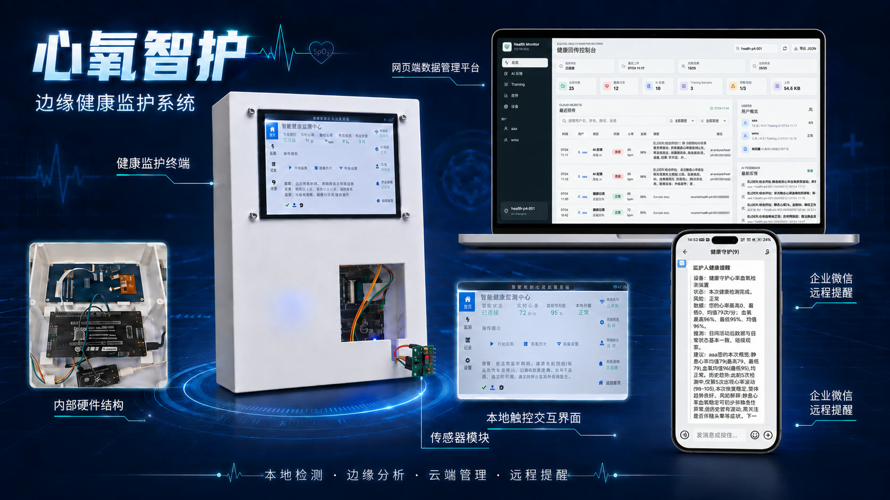
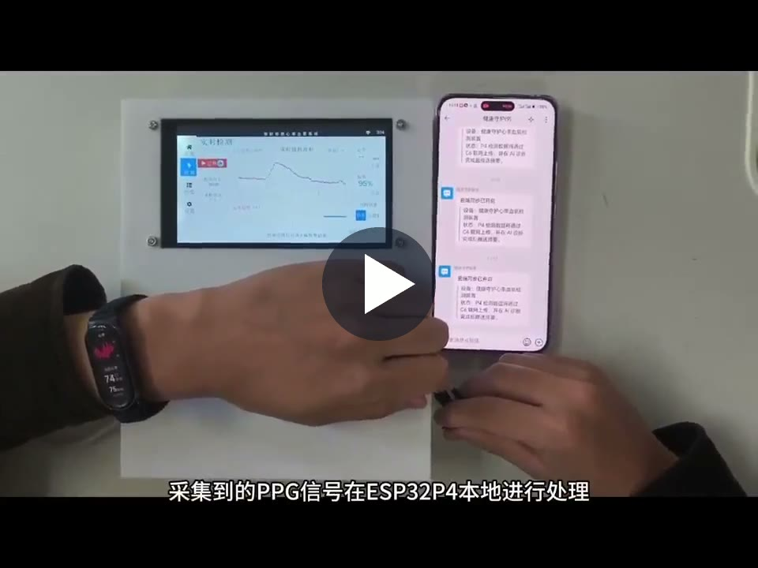
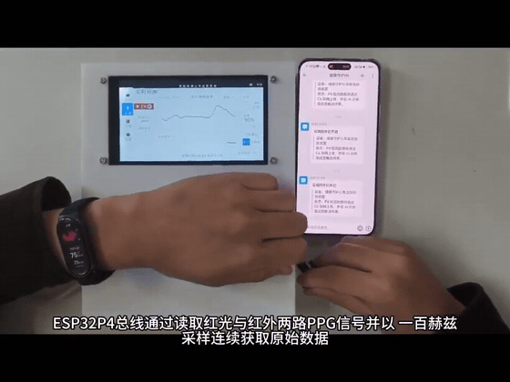
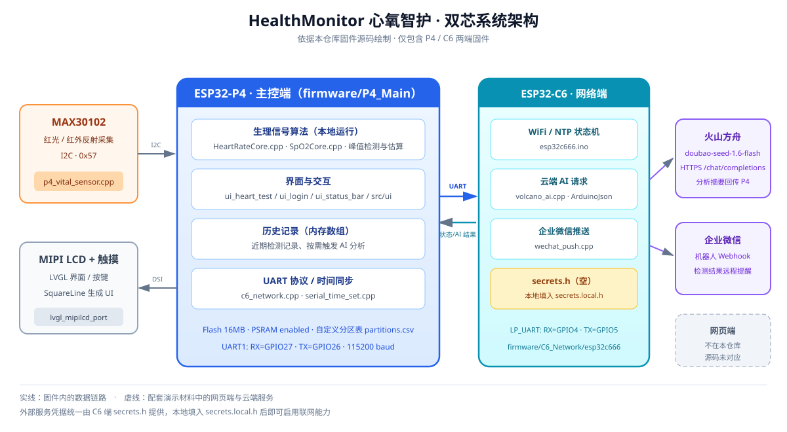
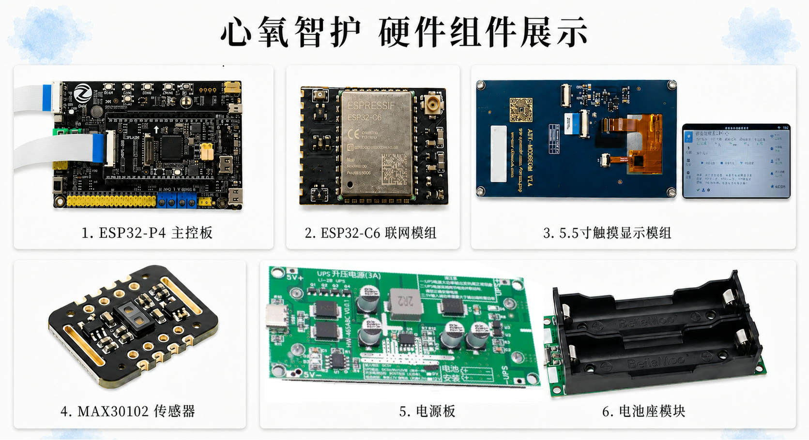
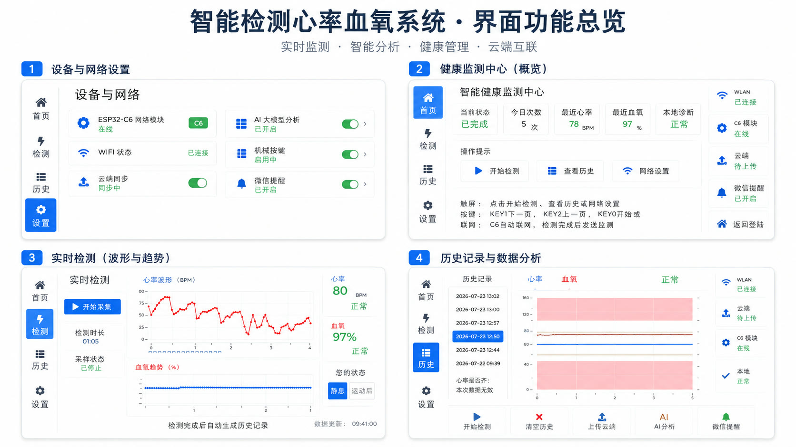

<div align="center">

# 心氧智护 · HealthMonitor

**ESP32-P4 + ESP32-C6 双芯协同的边缘健康监护终端**

[](LICENSE)


[](docs/BUILD.md)


</div>



PPG 信号采集、心率与血氧解算、触控交互运行在 **ESP32-P4**；Wi-Fi 联网、NTP 校时、云端 AI 请求与消息推送由 **ESP32-C6** 协同处理。两块芯片通过 UART 115200 互联，界面基于 LVGL 8 与 SquareLine 生成

---

## 🎬 演示 Demo

<div align="center">
  <a href="docs/videos/demo.mp4"></a>
</div>

<p align="center">
  <a href="docs/videos/demo.mp4"><b>▶ 观看完整演示视频</b></a> · 36 秒 · MP4 · 1.5 MB
</p>

<details>
<summary>展开动图预览</summary>

<div align="center">
  
  <br>
  <sub>PPG 采集 → 本地解算 → 端侧界面 → AI 健康分析 → 手机端提醒</sub>
</div>

</details>

---

## ✨ 特性

| 能力 | 实现 |
| --- | --- |
| 🫀 生理信号 | MAX30102 红光/红外采集，`HeartRateCore` / `SpO2Core` 在 P4 本地完成心率与血氧解算 |
| 🖥 触控界面 | LVGL 8 + SquareLine 生成 UI：登录、实时检测、历史记录、AI 结果、状态栏、时间设置 |
| 🔗 双芯协同 | P4 ↔ C6 UART 115200 协议，状态轮询、时间同步、AI 请求下发与结果回传 |
| ☁️ 云端能力 | C6 侧 Wi-Fi / NTP、火山方舟 `doubao-seed-1.6-flash` 请求、企业微信机器人推送 |
| 🔐 凭据管理 | 独立 `secrets.h` 空模板 + 本地 `secrets.local.h` 覆盖，四个宏集中配置外部服务 |
| 🛠 工程化 | 一键编译脚本、凭据自检、板卡参数与分区表、构建与硬件文档 |

---

## 🏗 系统架构



```
MAX30102 ──I2C──▶ ESP32-P4 ──UART 115200──▶ ESP32-C6 ──HTTPS──▶ 火山方舟 / 企业微信
                    │                          │
                    └─ LVGL UI · 心率/血氧解算  └─ WiFi · NTP · AI · 推送
```

1. MAX30102 经 I2C（`0x57`）接入 P4，`p4_vital_sensor.cpp` 采集原始 PPG 信号。
2. `HeartRateCore` / `SpO2Core` 完成本地解算，LVGL 渲染实时波形、历史记录与分析结果。
3. P4 通过 UART（GPIO26/27 ↔ GPIO4/5，115200）把 AI 请求交给 C6。
4. C6 发起 HTTPS 请求，将摘要回传 P4，同时向企业微信机器人推送检测结果。
5. 外部服务凭据统一由 `secrets.h` 提供，本地配置写入 `secrets.local.h`。

---

## 🔧 硬件



| 芯片 | 角色 | 源码 |
| --- | --- | --- |
| **ESP32-P4** | 主控 · 显示 · 算法 · 交互 | `firmware/P4_Main/sketch_apr26a/` |
| **ESP32-C6** | 联网 · AI 请求 · 消息推送 | `firmware/C6_Network/esp32c666/` |

| 接口 | 参数 | 来源 |
| --- | --- | --- |
| P4 UART | RX `GPIO27` · TX `GPIO26` · 115200 | `c6_network.cpp` |
| C6 LP_UART | RX `GPIO4` · TX `GPIO5` · 115200 | `esp32c666.ino` |
| MAX30102 | I2C `0x57` | `p4_vital_sensor.cpp` |
| 触摸屏 | I2C `0x14` | `lvgl_mipilcd_port.h` |
| LCD | RST `GPIO52` · BLK `GPIO53` | `mipilcd.h` |
| P4 编译选项 | Flash 16MB · PSRAM enabled · `partitions.csv` | `docs/BUILD.md` |

---

## 🖥 界面



设备与网络设置、健康监测中心、实时检测、历史记录与数据分析，全部由 SquareLine / LVGL 生成的界面源码驱动。

---

## 🚀 快速开始

### 1. 环境

| 组件 | 版本 |
| --- | --- |
| arduino-cli | 1.5.1（或 Arduino IDE 2.x） |
| ESP32 Arduino Core | `esp32:esp32 3.1.1` |
| 依赖库 | LVGL、ESP32_Display_Panel、ESP32_IO_Expander、esp-lib-utils、bb_captouch、ArduinoJson |

依赖通过 Arduino 库管理器或本地库目录提供，安装说明见 [docs/BUILD.md](docs/BUILD.md)。

### 2. 配置凭据

```bash
cd firmware/C6_Network/esp32c666
cp secrets.local.h.example secrets.local.h
```

| 宏 | 内容 |
| --- | --- |
| `WIFI_SSID` | 2.4GHz Wi-Fi 名称 |
| `WIFI_PASSWORD` | Wi-Fi 密码 |
| `WECHAT_WEBHOOK_URL` | 企业微信机器人完整 Webhook URL |
| `ARK_API_KEY` | 火山方舟 API Key，带 `Bearer ` 前缀 |

`secrets.h` 自动包含存在的 `secrets.local.h` 并以本地值覆盖空模板；`secrets.local.h` 由 `.gitignore` 忽略。详见 [config/README.md](config/README.md)。

### 3. 编译

```bash
bash tools/build.sh all          # P4 + C6
bash tools/build.sh p4           # 仅 P4
bash tools/build.sh c6           # 仅 C6
```

脚本自动准备纯 ASCII 构建目录、注入 `config/` 头文件路径、生成干净的依赖库副本；路径可用 `ARDUINO_CLI` / `ARDUINO_DATA` / `ARDUINO_LIBS` / `HM_BUILD_DIR` 覆盖。

### 4. 烧录

```bash
arduino-cli upload --fqbn esp32:esp32:esp32c6 --port COMx firmware/C6_Network/esp32c666
arduino-cli upload --fqbn "esp32:esp32:esp32p4:FlashSize=16M,PartitionScheme=custom,PSRAM=enabled" --port COMx firmware/P4_Main/sketch_apr26a
```

两块芯片分别烧录，串口波特率 115200；P4 使用 16MB Flash / PSRAM Enabled / Custom 分区。

---

## 📊 构建结果

2026-11-12 · Windows · arduino-cli 1.5.1 · `esp32:esp32 3.1.1-cn`

| 目标 | FQBN | Flash | RAM |
| --- | --- | --- | --- |
| ESP32-C6 | `esp32:esp32:esp32c6` | 1,114,929 B / 1,310,720 B（85%） | 43,712 B / 327,680 B（13%） |
| ESP32-P4 | `esp32p4:FlashSize=16M,PartitionScheme=custom,PSRAM=enabled` | 3,328,699 B / 16,777,216 B（19%） | 51,012 B / 327,680 B（15%） |

复现：`bash tools/build.sh all`。板卡参数、手动命令与排错见 [docs/BUILD.md](docs/BUILD.md)。

---

## 📁 目录结构

```
HealthMonitor-ESP32-P4/
├── firmware/
│   ├── P4_Main/sketch_apr26a/        # P4 主控：算法、LVGL UI、UART 协议、分区表
│   └── C6_Network/esp32c666/         # C6 联网：WiFi/NTP、AI、企微推送
│       ├── secrets.h                 # 空凭据模板
│       └── secrets.local.h.example   # 本地配置模板
├── config/                           # lv_conf.h、显示驱动配置
├── docs/
│   ├── images/                       # 系统图、架构图、界面图、演示动图与封面
│   ├── videos/demo.mp4               # 36 秒演示视频
│   ├── BUILD.md                      # 编译、烧录、排错
│   ├── HARDWARE.md                   # 引脚与硬件常量
│   └── legacy/                       # 原提交包说明与文件清单
└── tools/
    ├── build.sh                      # 一键编译两个固件
    └── check_secrets.py              # 凭据自检
```

---

## 📚 文档

| 文档 | 内容 |
| --- | --- |
| [docs/BUILD.md](docs/BUILD.md) | 编译环境、FQBN、手动命令、烧录与常见问题 |
| [docs/HARDWARE.md](docs/HARDWARE.md) | 双芯分工、UART 与外设常量及源码出处 |
| [config/README.md](config/README.md) | 库配置与四个凭据宏 |
| [docs/legacy/](docs/legacy/) | 竞赛提交包原始说明、依赖库说明、文件清单 |

---

## 👥 团队

四位成员对本项目**同等贡献**，按姓氏拼音排序（排名不分先后）。

| 陈仁强 | 高子明 | 潘宇川 | 谢万里 |
| :---: | :---: | :---: | :---: |

## 🤝 参与

欢迎通过 Issue 反馈问题、提交改进建议或分享复现结果。

## 📄 许可

[MIT](LICENSE) · 第三方库遵循各自原始许可证

---

<div align="center">

**心氧智护 HealthMonitor** · 2026 全国大学生物联网设计竞赛 · 乐鑫赛道

[github.com/imsquner/HealthMonitor-ESP32-P4](https://github.com/imsquner/HealthMonitor-ESP32-P4)

</div>
